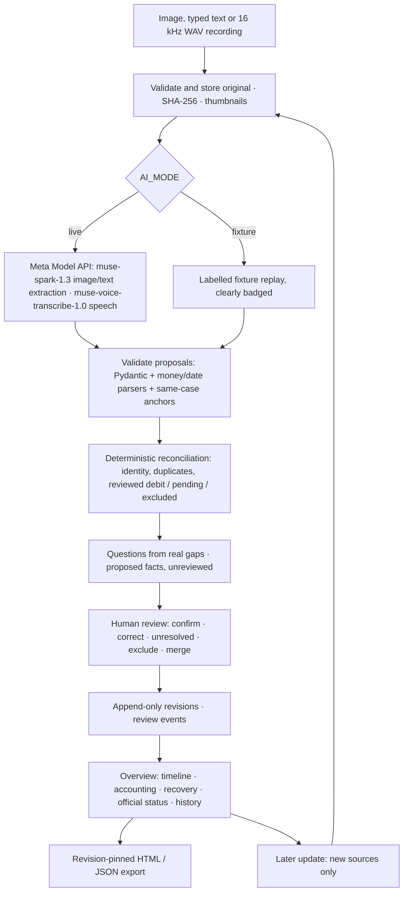

# CyberBrief

A source-linked cybercrime report-preparation and refund-tracking assistant for suspected UPI shopping scams in India. Citizens turn receipts, screenshots and a typed or spoken account into a human-reviewed case packet; later updates track partial or full refunds and record supplied official complaint updates. An officer sees what changed, verifies the reported transaction against a bank response where an integration exists, and approves every message that leaves the system.

**Status: hackathon prototype on fictional data.** It does not file complaints, contact banks, or connect to any police or government system. For a real financial cyber fraud, report immediately on **1930** or at **https://cybercrime.gov.in/** before preparing any packet.

## Project context

CyberBrief was developed for the Meta Global AI Developer Hackathon under the **Build for Your World** theme. It is a hackathon prototype that uses the Meta Model API in live mode and labelled fixtures for local demos.

### How Meta's models are used

All model calls are server side, through one adapter (`backend/app/ai.py`); the key is read from the environment and never reaches the browser.

- **Reading evidence:** `muse-spark-1.3` reads receipt images and typed accounts and proposes facts, each with a source anchor. `muse-voice-transcribe-1.0` turns a recorded account into text the citizen corrects before it is used.
- **Citizen chat assistant** (`backend/app/assistant.py`): `muse-spark-1.3` writes a strict-JSON reply proposal and, for replies about money, outcomes, time or status, labels each sentence in a second check. The model only proposes; code checks every reply for promises, outside referrals and figures the citizen did not give.
- **Officer investigation assistant** (`backend/app/investigation.py`): the model chooses which bounded tools to run (find connected reports, compare, verify a transaction, draft a request) and writes the summary; the tools, permissions and arithmetic are code.
- **Fixture mode** replays labelled responses so the app runs without a key. It is always badged in the UI, in runs and in exports, and is never reported as a live result.

## What it does

The citizen journey is three steps and an acknowledgement: **tell us what happened → add your evidence → answer a few questions → submit**, then track the status, add more details, or ask for the record to be closed and get a written answer. Closing a record ends CyberBrief's tracking of it; it never closes, withdraws or affects an official complaint.

- Intake: receipts and screenshots (JPEG/PNG/WebP), typed accounts (Hindi/English/Hinglish), recorded accounts (browser-encoded 16 kHz WAV), supplied official updates.
- Extraction (Meta Model API or labelled fixtures) proposes facts with source anchors; **nothing counts until a person confirms it**. Corrections create new versions; history is append-only.
- Deterministic accounting in integer paise: duplicate candidates need confirmation, pending and failed payments are kept apart, foreign currency stays outside INR totals.
- Targeted questions from real gaps; answers become new sources. Submitting with a question still open is allowed, and the acknowledgement lists it as not yet confirmed.
- Acknowledgement receipt stamped with the digest of a revision-pinned export.
- Closure requests: the citizen writes why, a simulated reviewer agrees or asks for more information, and the answer is shown back to them.
- Recovery track: refund claims (never counted), reviewed credit records, explicit allocations (excess rejected, never clamped), server-derived recovery state, reversal handling.
- Official status track: recorded only from supplied communications, latest by effective date, independent of recovery.
- **Chat assistant** (`/assistant`, signed in): talk it through in Hindi, English or Hinglish, typed or spoken. Rules suggest whether to register a complaint, the complaint is drafted from the chat, status is answered from the record, and CyberBrief is explained from a fixed help pack. Every change is a quick reply the citizen taps, a file they attach or a question they answer.
- **Officer side:** assigned cases, a case page with next action, evidence, messages and activity; every draft to a citizen or a bank is approved by the officer, and an approval covers exactly the words shown.
- **Transaction verification:** an officer verifies a reported payment against a bank response through a provider adapter. Without a configured integration only a labelled sandbox exists (**SIMULATED BANK RESPONSE**, never a production confirmation). When more is needed, the officer edits, approves and sends a request to the bank (by email only if an email service is configured; otherwise copy or download it). Replies are attached by the officer as officer-provided evidence and linked by a response reference.
- **Investigation assistant:** connections between reports, comparisons and how an earlier report was handled, on fictional reports only.
- Resolution summary for a simulated reviewer; change summary since the last review; revision-pinned HTML and JSON exports.

## How it works



The model proposes; Python decides inclusion rules, arithmetic, referential validity and state transitions; a person confirms. Recovery and official complaint status are separate tracks that never influence each other.

## Stack

React 19 · TypeScript · Vite 8 · Python 3.13 · FastAPI · Pydantic v2 · SQLAlchemy 2 · SQLite (WAL) · Alembic · LangGraph (thin graph, SQLite checkpointer) · Pillow for synthetic fixtures.

## Run locally

Prerequisites: Python 3.13, [uv](https://docs.astral.sh/uv/), Node 24, npm 11. Docker only for the compose demo. FFmpeg is optional.

```bash
cp .env.example .env                 # defaults to fixture mode; no model key required

cd backend && uv sync && cd ..       # add --extra fixtures to regenerate synthetic material
cd frontend && npm ci && npm run build && cd ..

uv run --project backend python scripts/seed_demo.py            # optional: named demo sessions + Demo A/B
uv run --project backend python scripts/seed_officer.py --officer-id CBI1042 --name "Demo reviewer"
cd backend && uv run uvicorn app.main:app --port 8000           # http://127.0.0.1:8000
```

On Windows PowerShell, use `Copy-Item .env.example .env` instead of `cp`. For Docker, copy the file the same way, then run `docker compose up --build`.

The landing page is public. **Citizens** sign in with a mobile number and a one-time code; the code is shown on screen because no SMS provider is configured, and `APP_ENV=production` turns that off. There is no password and no registration step: the first valid code creates the account. **Officers** sign in with an id and password and cannot register themselves; `seed_officer.py` prints a generated password once (or set `CB_OFFICER_PASSWORD`).

This is CyberBrief's own demo sign-in. It is not a bank or government login, and the officer role is a simulated reviewer label, not police authority.

Development with hot reload: `npm run dev` in `frontend/` (port 5173, proxies `/api` to 8000) alongside `uv run uvicorn app.main:app --reload` in `backend/`.

`AI_MODE=live` with an empty key refuses to start. Fixture mode is always labelled in the UI, runs and exports and never counts as a live demonstration. Verify live access with:

```bash
uv run --project backend python scripts/smoke_test_meta.py       # checks live access; sends no real data
```

### Demo data for the officer features

```bash
uv run --project backend python scripts/seed_workflow.py --staff-only          # the officers first
uv run --project backend python scripts/seed_investigation_demo.py            # nine fictional reports, indexed; adds nothing if already there
uv run --project backend python scripts/seed_verification_demo.py             # four fictional reports for transaction verification
uv run --project backend python scripts/backfill_intelligence.py              # rebuild the search index for this database's own reports (demo mode only)
```

## Docker

```bash
cp .env.example .env                 # PowerShell: Copy-Item .env.example .env
docker compose up --build            # one container, one worker, persistent volume at /app/data
```

Set `AI_MODE`, `PUBLIC_FIXTURES_ONLY` and `COOKIE_SECURE` in the environment; `MODEL_API_KEY` comes from `.env` and is never baked into the image. Public judging mode (`PUBLIC_FIXTURES_ONLY=true`) serves curated fictional cases only and rejects uploads and free-form input. The app is then at `http://127.0.0.1:8000` (`HOST_PORT=8080 docker compose up` if 8000 is taken). Seed the demo data inside the container, for example `docker compose exec cyberbrief python /app/scripts/seed_workflow.py --staff-only`.

## Configuration

All settings are environment variables (read from `.env`, never from code). Names only here; `.env.example` has the defaults.

| Variable | Meaning |
|---|---|
| `AI_MODE` | `fixture` (default in Docker) replays labelled responses; `live` calls the Meta Model API. |
| `MODEL_API_KEY` | Meta Model API key. Server side only; empty in `fixture` mode. |
| `META_BASE_URL`, `META_TEXT_MODEL`, `META_SPEECH_MODEL` | Model API endpoint and model names. |
| `APP_ENV`, `DEMO_MODE`, `PUBLIC_FIXTURES_ONLY`, `COOKIE_SECURE` | Run mode, demo behaviour, public judging mode, HTTPS cookies. |
| `DATABASE_URL`, `STORAGE_ROOT`, `CHECKPOINT_DB` | SQLite database and private file storage. |
| `BANK_SANDBOX_ENABLED`, `BANK_PROVIDER_*` | The labelled bank sandbox and provider call limits. A real bank integration reads its URL and token from variables named in `workflow_config.json`. |
| `EMAIL_MODE`, `SMTP_*`, `EMAIL_FROM_ADDRESS`, `OFFICIAL_*` | Optional email to a bank and the officer's contact block. Off by default: nothing is sent. |
| `LANGSMITH_*` | Optional tracing, off by default. |

## Checks

```bash
cd backend && uv run ruff check app ../scripts
cd frontend && npx tsc --noEmit
```

Evaluation over the held-out packs (fixture replay measures the pipeline; live needs a key):

```bash
uv run --project backend python scripts/run_evaluation.py --split holdout --mode fixture
uv run --project backend python scripts/run_evaluation.py --split holdout --mode live
```

## Repository layout

```
backend/     FastAPI app (app/), Alembic migrations
frontend/    Vite + React UI
evals/       fixture packs (development/holdout/assistant), audio clips, evaluation runners
scripts/     smoke test, seeding, fixture generators, evaluation runners
data/        runtime data (gitignored)
```

## Limits (honest list)

- Fixture mode is a replay, not a live Meta call. A result counts as live only where a run is labelled live.
- Bank verification is a sandbox on fictional records. A real integration needs a bank-side gateway, a URL and a token; none exists in this repository. Email needs an SMTP service and is untested against a real mail server. There is no inbound email: replies are attached by hand.
- It does not remove the wait for a bank and does not recover money.
- Hindi and Hinglish audio fixtures are pending owner recordings (no Hindi TTS voice on the build machine).
- No police partnership, bank integration, NCRP integration, pilot, or measured efficiency improvement exists.
- Automated test suites are not included in this repository.
- Single worker and SQLite; not designed for horizontal scaling.

## Before publishing

- Commit the source code and `.env.example`. The `.gitignore` intentionally excludes `.env` and allows `.env.example`.
- Keep `.env`, API keys, SMTP credentials, local databases and uploaded evidence out of the public repository.
- Add the public repository URL, demo video and contributor names to the hackathon submission form itself, where requested; these details do not belong as placeholders in this README.
- Test the published run instructions from a clean checkout and include a short demo showing fixture mode clearly labelled. Do not describe fixture output as a live model result or simulated bank response as a real bank confirmation.
